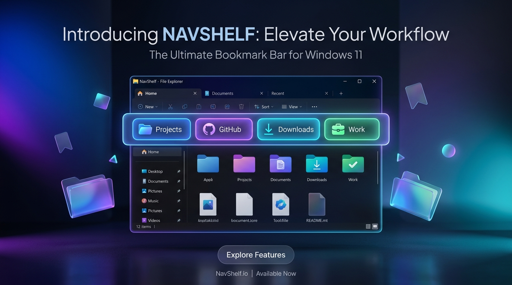

<div align="center">

# NavShelf — Bookmark Bar for Windows File Explorer

**The fastest way to access your favourite folders in Windows 11 & 10 File Explorer.**  
Pin folders to a Chrome-style bookmark bar, open them in new tabs with middle-click, and never dig through the sidebar again.

[](https://navshelf.nexonic.dev/)
[](https://navshelf.nexonic.dev/)
[](LICENSE)
[](https://dotnet.microsoft.com/)
[](https://navshelf.nexonic.dev/)

🌐 **Website:** [navshelf.nexonic.dev](https://navshelf.nexonic.dev/) &nbsp;|&nbsp; ⭐ **Star this repo if you find it useful!**



</div>

---

## What is NavShelf?

NavShelf is a free, open-source Windows utility that adds a **horizontal bookmark bar** directly beneath the tabs of Windows 11 and Windows 10 File Explorer — the same concept as the bookmarks bar in Google Chrome or Microsoft Edge, but for your local **folders**.

> **Search terms:** Windows File Explorer bookmark bar · Windows Explorer favorites bar · pin folders Windows 11 · open folder in new tab Windows · Windows 11 file explorer extension · Windows folder shortcuts

---

## ✨ Key Features

| Feature | Description |
|---|---|
| 📌 **Native Explorer Embed** | Docks seamlessly under Explorer tabs with zero gap. No overlay, no separate window. |
| 🖱️ **Middle-Click → New Tab** | Scroll-wheel click any bookmark to open the folder in a new Explorer tab, Chrome-style. |
| 🌓 **Live Dark / Light Mode Sync** | Automatically follows your Windows theme in real time with native Fluent colors. |
| 📂 **Open & Save Dialog Support** | Works inside file dialogs in VS Code, Photoshop, Chrome, and every other Windows app. |
| 😀 **Emoji & Custom Icons** | Give each bookmark a custom icon (folder, code, music, star…) and emoji prefix. |
| ⌨️ **Global Hotkey** | Press `Ctrl + Shift + B` from anywhere to toggle the bar. |
| 🪶 **Ultra Lightweight & Portable** | Single ~108 KB `.exe`. No installer, no admin rights, no registry edits needed. |
| 🛡️ **100% Safe** | Uses the official Win32 `SetParent` API. Zero DLL injection, zero system file patches. |
| 💻 **System Tray & Auto-Startup** | Runs quietly in the tray with an optional "Launch on Windows Startup" setting. |

---

## 🚀 Quick Start

1. **[Download NavShelf.exe](https://navshelf.nexonic.dev/)** (~108 KB)
2. **Double-click** `NavShelf.exe` — no install, no UAC prompt.
3. **Open Windows File Explorer** — the bookmark bar appears automatically beneath the tabs.
4. **Drag any folder** onto the bar to pin it, or right-click a bookmark to edit, rename, or remove it.
5. **Middle-click** a bookmark to open it in a new Explorer tab.

---

## ⌨️ Keyboard & Mouse Shortcuts

| Action | Shortcut |
|---|---|
| Open folder in current tab | Left Click |
| Open folder in **New Tab** | Middle Click (Scroll Wheel) |
| Open folder in New Window | Ctrl + Left Click |
| Rename / change icon / delete | Right Click → Context Menu |
| Add a new bookmark | `+ Add` button |
| Toggle bookmark bar visibility | `Ctrl + Shift + B` |
| Close / exit NavShelf | `✕` button on the bar |

---

## 🛠️ Tech Stack & Requirements

- **OS:** Windows 10 (1809+) or Windows 11 (22H2 / 23H2 / 24H2+)
- **Runtime:** .NET Framework 4.8 *(pre-installed on all modern Windows)*
- **Language:** C# + WPF + Win32 Interop
- **Size:** ~108 KB (single portable `.exe`)

---

## 📦 Project Structure

```
NavShelf/
├── App.xaml / App.xaml.cs          # Entry point, system tray, global hotkeys
│
├── Models/
│   ├── AppSettings.cs              # Settings schema (height, spacing, padding)
│   └── BookmarkItem.cs             # Bookmark schema (name, path, icon, color)
│
├── Services/
│   ├── BookmarkManager.cs          # Bookmark storage & JSON persistence
│   ├── ExplorerChildBarManager.cs  # Win32 WS_CHILD window attachment & layout
│   ├── ExplorerComHelper.cs        # Shell COM navigation (tabs, windows, dialogs)
│   ├── ExplorerHookEngine.cs       # Window tracking & shell hooks
│   ├── ThemeManager.cs             # Live Windows Dark/Light theme sync
│   └── Win32Helper.cs              # Win32 API declarations & utilities
│
└── Views/
    ├── BookmarkBarControl.xaml     # Main bookmark bar UI
    ├── BookmarkEditDialog.xaml     # Add / Edit bookmark dialog
    └── SettingsWindow.xaml         # Settings UI (height, spacing, startup)
```

---

## 🤔 Frequently Asked Questions

**Q: Does NavShelf work with Windows 10?**  
A: Yes. NavShelf supports Windows 10 (1809 and later) and all versions of Windows 11.

**Q: Is NavShelf safe? Does it modify system files?**  
A: NavShelf is 100% safe. It uses the official Win32 `SetParent` API — no DLL injection, no patching of `explorer.exe`, no registry modifications. The full source code is available here on GitHub.

**Q: Where are my bookmarks stored?**  
A: Bookmarks are saved in `%AppData%\NavShelf\bookmarks.json`. You can back it up or copy it to any PC.

**Q: Does it work in Open / Save file dialogs?**  
A: Yes. NavShelf attaches to the common file dialog window (`#32770`) used by virtually every Windows application — VS Code, Photoshop, Chrome, Notepad, and more.

**Q: How do I uninstall it?**  
A: Simply close NavShelf from the system tray and delete the `.exe`. There is nothing else to remove.

---

## 📄 License

This project is licensed under the [MIT License](LICENSE) — free for personal and commercial use.

---

<div align="center">

Made with ❤️ for Windows power users &nbsp;|&nbsp; [navshelf.nexonic.dev](https://navshelf.nexonic.dev/)

</div>
